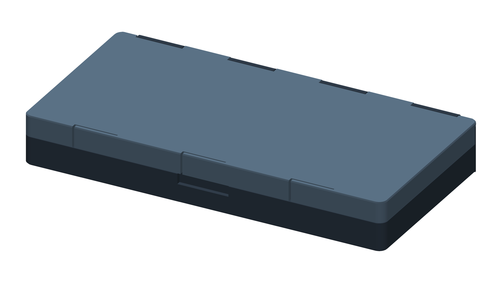
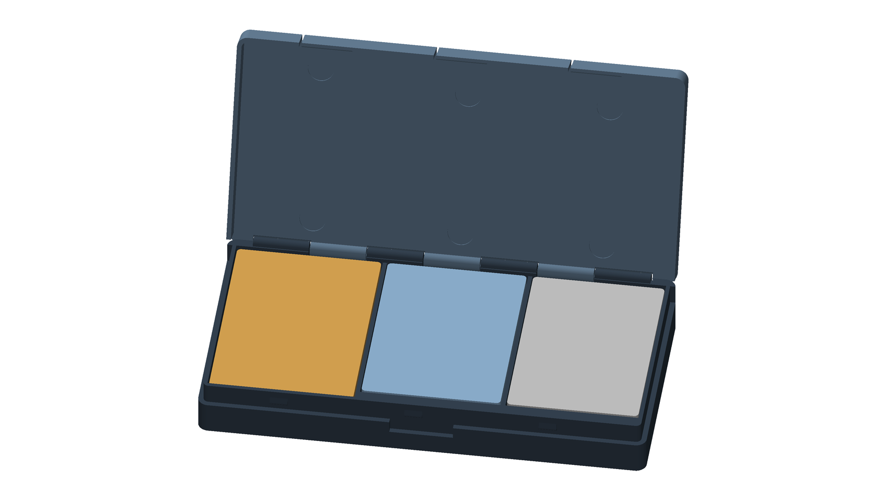

# Teenage Engineering TX-6 + CM-15 + TP-7 travel case

A slim two-part 3D-printed clamshell that holds the **TX-6**, **CM-15** and **TP-7** side by side,
each in its own snug pocket, under a hinged lid with three snap latches.




| | |
|---|---|
| **Outside size** | 211.3 × 105.8 × 28.8 mm (hinge barrels add 2.4 mm at the back) |
| **Parts** | `case_base.stl`, `case_lid.stl` — both already in print orientation |
| **Supports** | none, anywhere |
| **Bed needed** | ≥ 215 × 110 mm (fits a 220 × 220 bed such as Ender 3, Prusa MK3/MK4, Bambu A1/P1/X1) |
| **Material** | **PETG** recommended (the latch fingers flex; PLA works but can crack over time) |
| **Rough filament** | ~250 g total (base ~180 g, lid ~65 g). Your slicer will give the exact figure |

## What to print and buy

| Item | Notes |
|---|---|
| `output/case_base.stl` | floor on the bed, as exported |
| `output/case_lid.stl` | exported **upside-down** (top face on the bed) so the latch fingers print as free-standing walls. Do not flip it. |
| 1.75 mm filament, **185 mm** long | the hinge pin (any scrap piece of PETG/PLA filament, or a 1.6–1.7 mm wire) |
| Self-adhesive foam dots, ≈ 12 mm × 3 mm | optional but recommended; six recesses in the lid mark where they go |

### Slicer settings

* 0.2 mm layers, 0.4 mm nozzle, **4 perimeters**, 15–20 % infill, **no supports**. A brim is optional (helps keep the long flat lid from lifting at the corners).
* PETG: nozzle ~240 °C, bed ~80 °C, part cooling 30–50 %.

## Assembly (2 minutes)

1. Set the lid on the base in the **closed position** (just lower it straight down — the hinge barrels
   interleave without needing to be angled) and press the front edge until all three latches click.
2. From the **left end** of the hinge, push the 185 mm filament pin through all seven barrels until it
   stops at the blind end on the right.
3. The pin should end about 1 mm inside the countersink on the left. Touch a lighter / soldering iron to
   that end for a second and press it flat into the countersink — it forms a rivet head that keeps the pin
   in. (Optional: a dab of super glue instead.)
4. Peel & stick the foam dots into the six round recesses in the lid.
5. Open the case (thumb notch is under the middle latch), drop the devices in. Push up through the round
   holes in the base floor to lift a device out.

The lid opens to **139°** and rests against a built-in hard stop.

**TX-6 note:** the pocket is sized for the TX-6 *without* its removable 6.35 mm jack adapter (90 mm long,
102 mm with it). Take the adapter off before stowing it.

## How it is put together (and why)

| Feature | Dimension | Reason |
|---|---|---|
| Pockets | device + 0.5 mm per side, 0.5 mm corner radius | snug, but the device drops in even if the printer under-sizes the pocket by 0.2 mm |
| Stepped floors | TX-6 floor 2.0, CM-15 6.0, TP-7 9.0 mm | the three devices have different thicknesses (23 / 19 / 16 mm); stepping the floor puts all three tops in **one plane** so the lid presses on them evenly |
| Headroom | 1.8 mm between device tops and lid | clears knobs/faders if the published size is a hair low; 3 mm foam dots compress ~40 % and take up the slack so nothing rattles |
| Dividers | 2.0 mm, stop 2 mm below the rim | hold devices sideways without ever bottoming on the foam |
| Push-out holes | Ø18 mm in the floor under each pocket | a snug pocket needs a way to get the device out without prying |
| Telescoping lid | skirt 2.2 mm, 0.3 mm running gap, 12 mm overlap | the lid is located on three sides by the skirt and on the fourth by the hinge, and the seam is flush |
| Latches ×3 | 24 mm snap fingers cut into the lid's front skirt | bend *in the plane of the print layers* (the strong direction); 0.64 mm deflection, 0.83 % strain, ~10 N each |
| Latch faces | 45° retaining face, ~22° lead-in | 45° is the steepest overhang that prints cleanly, and it makes the click positive but easy to release |
| Hinge | 7 interleaved 26 mm barrels on a 1.75 mm filament pin | strong, quiet, no print-in-place clearances to get wrong; barrel tops are flush with the lid |
| Gussets | 45° under every barrel and ridge | guarantees support-free printing |
| First-layer chamfer | 0.6 mm on the bed-side edges | avoids "elephant foot" so the lid and base slide together cleanly |


## Dimensions used

Taken from the manufacturer's product pages (teenage.engineering). The pages do not label which number
is width / length / thickness; the smallest is the thickness, and the footprint is the same rectangle
whichever way you read the other two.

| Device | Size (mm) | Pocket (mm) | Floor height |
|---|---|---|---|
| TX-6  | 90 × 62 × 23   | 91 × 63 × (24.5 deep) | 2.0 |
| CM-15 | 90 × 65.5 × 19 | 91 × 66.5 × (20.5 deep) | 6.0 |
| TP-7  | 96 × 68 × 16   | 97 × 69 × (17.5 deep) | 9.0 |

**Check before you print:** measure your devices with calipers. If any is more than ~0.3 mm bigger than the
table, edit `DEVICES` (or `CLR_XY`) at the top of `build_case.py` and re-run — everything is parametric.
If a device has anything that sticks out beyond its published size (knobs, the TP-7 reel), the 1.8 mm
headroom is what absorbs it.

## What was verified, and what was not

`python3 verify_case.py` builds both parts and runs 33 hard pass/fail checks, all passing:

* **Mesh:** both STLs watertight, single solid body, no degenerate faces, sit on the bed.
* **Clearances:** lid-to-base gap is 0.30 mm everywhere (0.106 mm across the 45° latch faces by design);
  no intersections in the closed pose.
* **Hinge:** the lid is swept 0°→139° in the CAD kernel; zero collisions with the base, and zero with any
  device in any extreme position. 139° is the first contact, which acts as the stop.
* **Snap fit:** the finger must flex 0.64 mm to pass the ridge, at 0.83 % strain (PETG limit ≈ 2 %).
* **Devices:** modelled with 1 mm corner radius at all nine extreme positions in their pockets, plus a
  razor-sharp-cornered worst case: all fit.
* **Printability:** no face overhangs more than 45° in either part (the checker was proven able to fail:
  it caught a bridging slot in an earlier revision, since fixed); the thinnest wall anywhere is 1.2 mm
  (the closed end of the pin bore); two independent thin-wall detectors, calibrated on known 0.5/0.8/1.2 mm
  walls, find nothing under 1.0 mm.

**Not verified — be honest about this:** nobody has printed this yet. The geometry is checked virtually
against the published device sizes; real printers, filaments and the devices' real corner radii and
protrusions can differ. The latch force figures (~10 N per finger) are beam-theory estimates for PETG. The
parameters that absorb real-world variation (`CLR_XY`, `GAP`, `HEADROOM`) are at the top of
`build_case.py`.

## Files

```
output/case_base.stl                  print this (floor down)
output/case_lid.stl                   print this (as exported, top face down)
output/case_assembly_closed.stl       both parts closed, for looking at / slicer preview
output/case_base.step                 editable CAD (base)
output/case_lid_assembled_pose.step   editable CAD (lid, in its closed position)
build_case.py                         the parametric model (all dimensions at the top)
verify_case.py, thinwall.py           the verification suite
render_previews.py, zrender.py        regenerate previews/
```

Rebuild: `pip install -r requirements.txt && python3 build_case.py && python3 verify_case.py`
